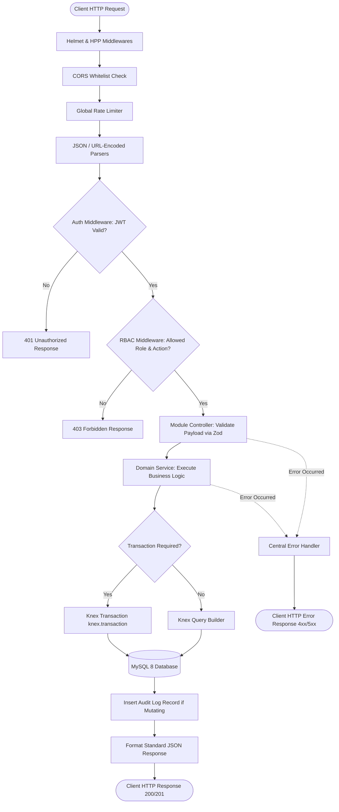

# PrimeRoute Backend Architecture Specification

**One-line purpose:** Comprehensive architectural blueprint, technical stack rationale, folder organization, request pipeline, and service layer patterns for the PrimeRoute backend.  
**Last updated:** November 16, 2026  
**Status:** Complete  

---

## 1. System Overview

PrimeRoute is an enterprise fleet and vehicle rental management platform engineered to manage commercial vehicle leasing, rental lifecycle tracking, preventative maintenance scheduling, citation matching, driver accounting, and role-based operational workflows. The platform is designed to handle fleets from 31 to 75+ vehicles with horizontal architectural readiness to support several hundred vehicles.

The backend service operates as a stateless RESTful JSON API interfacing with a persistent MySQL relational database.

```
+-------------------------------------------------------------+
|                      React 18 Frontend                      |
|            (Tailwind CSS, Lucide Icons, Vite)               |
+-------------------------------------------------------------+
                              |
                              | HTTPS / JSON (REST API)
                              v
+-------------------------------------------------------------+
|                  PrimeRoute Express.js API                  |
|    Security Pipeline (Helmet, CORS, HPP, Rate Limiting)     |
|    Authentication & RBAC Guards (JWT, Roles Matrix)         |
+-------------------------------------------------------------+
                              |
                              | Controller -> Service -> Knex.js
                              v
+-------------------------------------------------------------+
|               MySQL 8 Relational Database                   |
|       (30 Tables, InnoDB, ACID, Strict Constraints)         |
+-------------------------------------------------------------+
```

---

## 2. Technology Stack & Rationale

| Layer / Library | Technology | Selection Rationale |
| :--- | :--- | :--- |
| **Runtime** | Node.js (v20 LTS) | Non-blocking, event-driven asynchronous I/O ideal for concurrent API operations, PDF document rendering, and scheduled maintenance background jobs. |
| **Framework** | Express.js (v4.21) | Minimalist, predictable HTTP server layer with rich middleware composition capabilities. |
| **Database** | MySQL 8 (InnoDB) | Full ACID compliance, foreign key cascade/restrict guarantees, and transactional isolation required for financial ledger immutability and rental overlap locking. |
| **Query Engine** | Knex.js (v3.1) | Programmatic SQL query builder and migration engine. Provides strict parameterization to prevent SQL injection without the overhead or impedance mismatches of heavy ORMs. |
| **Validation** | Zod (v3.24) | Strictly typed runtime schema parsing for environment variables, authentication payloads, and incoming request bodies. |
| **Authentication** | JSON Web Tokens (`jsonwebtoken`) & `otplib` | Stateless short-lived JWT access tokens with long-lived hashed refresh tokens and standard RFC 6238 TOTP two-factor authentication. |
| **Security** | `helmet`, `cors`, `hpp`, `express-rate-limit`, `bcryptjs` | Hardened HTTP response headers, origin whitelisting, HTTP parameter pollution defense, brute-force mitigation, and salted password hashing. |
| **Logging** | Pino & Pino-HTTP (v9/v10) | Ultra-low-overhead structured JSON logging with native redaction support for sensitive PII. |
| **Background Tasks** | `node-cron` (v3.0) | Deterministic cron scheduling for daily inspection, license expiration, and maintenance odometer check routines. |
| **Testing** | Jest (v29) & Supertest (v7) | Unit and HTTP integration test runner providing deterministic assertions against mocked and real database instances. |

---

## 3. Directory Structure

```
backend/
├── db/
│   ├── migrations/         # Knex database schema migration definitions (001 to 012)
│   ├── seeds/              # Seed scripts for initial roles, settings, rules, and sample data
│   └── primeroute.sql      # Full MySQL database SQL dump of all 30 tables
├── docs/                   # Architectural, operational, and API system documentation
│   ├── 01_ARCHITECTURE.md
│   ├── 02_DATABASE_SCHEMA.md
│   ├── 03_API_MAP.md
│   ├── 04_RBAC_PERMISSIONS.md
│   ├── 05_AUTH_AND_SECURITY.md
│   ├── 06_DATA_FLOW.md
│   ├── 07_FRONTEND_INTEGRATION.md
│   ├── 08_IMPLEMENTATION_MAP.md
│   ├── 09_ALERTS_AND_NOTIFICATIONS.md
│   ├── 10_ENVIRONMENT_SETUP.md
│   ├── 11_DEPLOYMENT.md
│   ├── 12_BACKUP_AND_RESTORE.md
│   ├── 13_TESTING_AND_ACCEPTANCE.md
│   ├── 14_CLIENT_HANDOVER.md
│   └── CHANGELOG.md
├── src/
│   ├── config/             # Runtime constants, database connection pool, and Zod env validator
│   ├── jobs/               # Background scheduled tasks (expiration monitors, odometer polling)
│   ├── middlewares/        # Authentication, RBAC checks, rate limiters, and error handling
│   ├── modules/            # Domain-driven feature modules (controllers, services, repositories)
│   │   ├── accidents/      # Accident incident logging and insurance claim linkage
│   │   ├── accounting/     # Double-entry ledger, invoice generation, escrow deposits, payouts
│   │   ├── audit/          # Read-only audit log queries
│   │   ├── auth/           # Login, MFA verification, token refresh, password resets
│   │   ├── documents/      # File metadata management and document version history
│   │   ├── drivers/        # Driver profiles, license tracking, PII masking, balance caching
│   │   ├── employee_paperwork/ # Digital onboarding, tax info, direct deposit agreements
│   │   ├── expenses/       # Operating expense logging and vehicle attribution
│   │   ├── inspections/    # Check-in/check-out condition reports and photo attachments
│   │   ├── insurance/      # Policy coverage tracking and insurance claim lifecycles
│   │   ├── maintenance/    # Service orders, repair logs, and 5,000-mile preventative alerts
│   │   ├── notifications/  # Notification rule configuration and alert history tracking
│   │   ├── rentals/        # Rental contracts, rate schedules, amendments, and digital signatures
│   │   ├── reports/        # Fleet utilization, P&L aggregation, and export generation
│   │   ├── settings/       # Company profile, system toggles, and business parameters
│   │   ├── tolls_tickets/  # Violation ingestion, rental window matching, and driver charging
│   │   ├── users/          # Employee user administration and invitation workflows
│   │   └── vendors/        # External maintenance shops, insurers, and authorities directory
│   ├── services/           # Cross-cutting infrastructure services (mailer, storage, token helper)
│   ├── utils/              # Structured logger, response helper, and error abstractions
│   ├── app.js              # Express application assembly and middleware pipeline
│   ├── routes.js           # API v1 route aggregator mounting all domain routers
│   └── server.js           # HTTP listener bootstrap with dynamic port recovery
├── tests/                  # Automated integration and health check test suites
├── uploads/                # Local physical storage for uploaded photos and documents
├── .env.example            # Environment configuration template
├── knexfile.js             # Knex configuration for development, test, and production stages
├── package.json            # Node.js project manifest and script definitions
└── README.md               # Quickstart guide and developer handbook
```

---

## 4. Request & Response Lifecycle

Every HTTP request to PrimeRoute flows through a strict, multi-layered pipeline:



### Standard Response Envelope
All PrimeRoute endpoints emit a consistent JSON envelope:

#### Success Response (200 / 201)
```json
{
  "success": true,
  "data": {
    "id": "1",
    "status": "active"
  }
}
```

#### Error Response (4xx / 5xx)
```json
{
  "success": false,
  "error": {
    "message": "Vehicle with this VIN already exists in the system.",
    "code": "DUPLICATE_VIN"
  }
}
```

---

## 5. Domain Modules List

The application divides its domain into 18 specialized modules:

1. **`auth`**: User credential verification, TOTP verification, JWT session renewal, invitation claiming.
2. **`users`**: Administrative CRUD for employee accounts and role assignments.
3. **`vehicles`**: Physical fleet inventory, lifecycle statuses (`available`, `rented`, `maintenance`, `sold_retired`), acquisition data.
4. **`drivers`**: Customer records, driving credentials, balance caching, PII masking.
5. **`rentals`**: Commercial lease contracts, weekly rental pricing, mileage caps, deposit escrow tracking.
6. **`inspections`**: Vehicle check-in/out reports, fuel levels, odometer readings, and condition photographs.
7. **`accidents`**: Incident records, third-party collision reports, and insurance claim connections.
8. **`insurance`**: Commercial fleet policy registry, renewals, deductible tracking, and claim lifecycles.
9. **`vendors`**: External service suppliers (mechanic shops, body shops, municipal authorities).
10. **`expenses`**: Operating expenditures attributed to individual vehicles and system expense categories.
11. **`maintenance`**: Scheduled servicing orders, emergency repairs, and preventative oil change tracking.
12. **`accounting`**: Double-entry style financial transaction ledger (`ledger_entries`), driver invoices, and deposits.
13. **`tolls_tickets`**: Moving violations, parking tickets, toll authority charges matched to rental windows.
14. **`documents`**: Document repository (titles, registrations, leases) with version history.
15. **`employee_paperwork`**: Internal staff onboarding, tax withholdings, direct deposit details.
16. **`reports`**: Financial P&L statements, fleet utilization metrics, and tabular CSV exports.
17. **`settings`**: Global system parameters, grace periods, deposit defaults, and company branding.
18. **`notifications`**: Rule-based alert engine, scheduled monitors, and user notification feeds.
