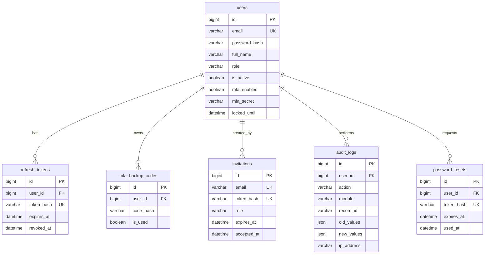
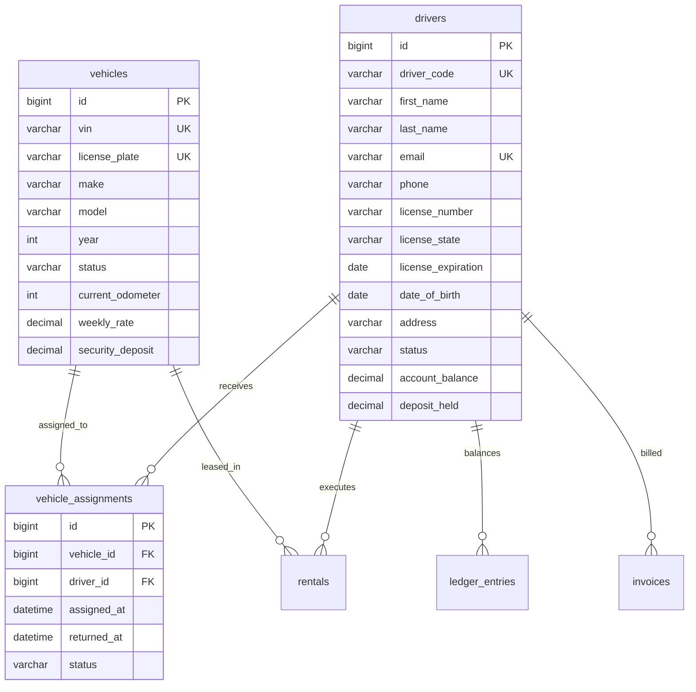
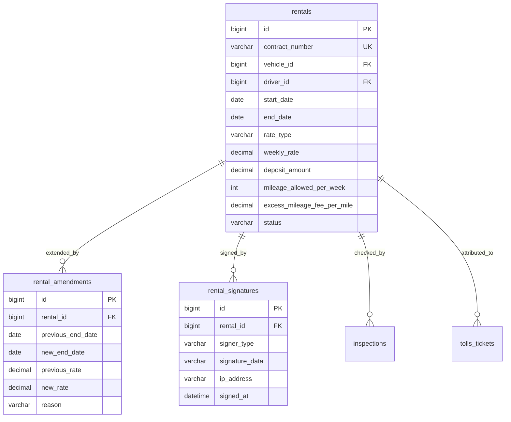
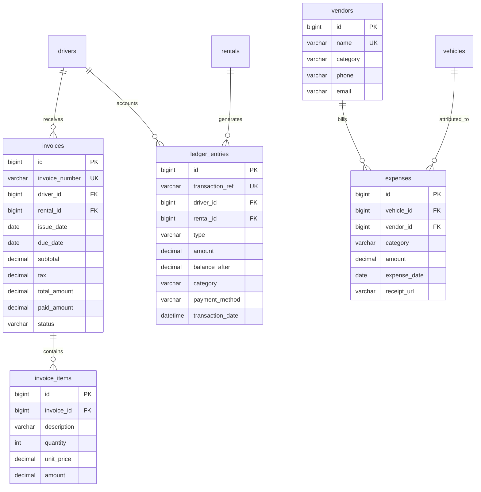
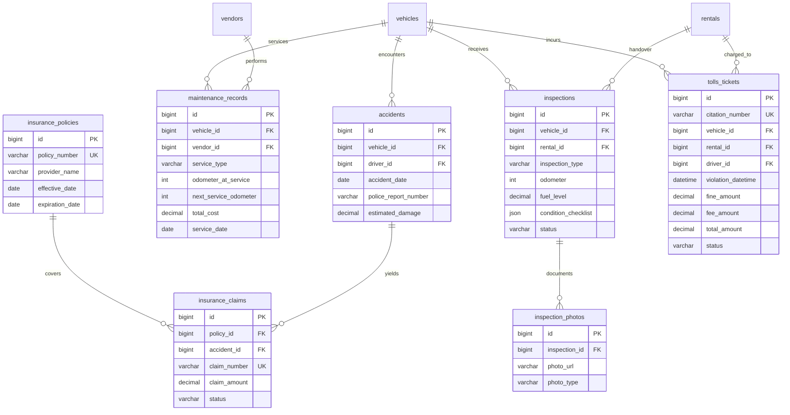

# PrimeRoute Database Schema Specification

**One-line purpose:** Comprehensive database catalog defining all 30 relational entities, column specifications, foreign keys, indexes, Mermaid ER diagrams, and core transactional integrity rules.  
**Last updated:** November 16, 2026  
**Status:** Complete  

---

## 1. Overview & Storage Standards

All PrimeRoute tables are implemented with the following foundational standards:
- **Storage Engine:** `InnoDB` (ACID compliant with strict foreign key referential integrity).
- **Character Set & Collation:** `utf8mb4` with `utf8mb4_unicode_ci`.
- **Primary Keys:** `BIGINT UNSIGNED AUTO_INCREMENT` on all business records.
- **Auditing Timestamps:** Every table contains `created_at` and `updated_at` timestamps defaulting to `CURRENT_TIMESTAMP`.
- **Monetary Precision:** All currency fields use `DECIMAL(12, 2)` (never floating point).

---

## 2. Mermaid Entity-Relationship Diagrams

### 2.1 Users, Authentication & Audit Security

### 2.2 Fleet Inventory & Driver Management

### 2.3 Rental Agreements & Digital Signatures

### 2.4 Financial Ledger, Invoicing & Operating Expenses

### 2.5 Fleet Operations: Inspections, Maintenance & Citations

---

## 3. Comprehensive Table Catalog (30 Tables)

### Area 1: Users, Authentication & Audit Security

#### 1. `users`
- **Purpose:** System employee profiles, credentials, role-based security, and MFA flags.
- **Columns:**
  - `id`: `BIGINT UNSIGNED NOT NULL AUTO_INCREMENT` (PK)
  - `email`: `VARCHAR(191) NOT NULL` (Unique)
  - `password_hash`: `VARCHAR(255) NOT NULL`
  - `full_name`: `VARCHAR(100) NOT NULL`
  - `role`: `ENUM('owner','secondary_admin','finance','fleet_maintenance','rental_operations','readonly_manager') NOT NULL`
  - `phone`: `VARCHAR(30) NULL`
  - `avatar_url`: `VARCHAR(255) NULL`
  - `is_active`: `TINYINT(1) NOT NULL DEFAULT 1`
  - `mfa_enabled`: `TINYINT(1) NOT NULL DEFAULT 0`
  - `mfa_secret`: `VARCHAR(255) NULL`
  - `failed_login_attempts`: `INT UNSIGNED NOT NULL DEFAULT 0`
  - `locked_until`: `DATETIME NULL`
  - `last_login_at`: `DATETIME NULL`
  - `created_at`: `TIMESTAMP DEFAULT CURRENT_TIMESTAMP`
  - `updated_at`: `TIMESTAMP DEFAULT CURRENT_TIMESTAMP ON UPDATE CURRENT_TIMESTAMP`
- **Indexes:** `idx_users_role`, `idx_users_is_active`.

#### 2. `refresh_tokens`
- **Purpose:** Long-lived cryptographically hashed JWT refresh tokens.
- **Columns:**
  - `id`: `BIGINT UNSIGNED NOT NULL AUTO_INCREMENT` (PK)
  - `user_id`: `BIGINT UNSIGNED NOT NULL` (FK -> `users.id` ON DELETE CASCADE)
  - `token_hash`: `VARCHAR(255) NOT NULL` (Unique)
  - `expires_at`: `DATETIME NOT NULL`
  - `revoked_at`: `DATETIME NULL`
  - `ip_address`: `VARCHAR(45) NULL`
  - `user_agent`: `VARCHAR(255) NULL`
  - `created_at`, `updated_at`
- **Indexes:** `idx_refresh_tokens_user_id`.

#### 3. `mfa_backup_codes`
- **Purpose:** Hashed single-use emergency backup codes for multi-factor login recovery.
- **Columns:**
  - `id`: `BIGINT UNSIGNED NOT NULL AUTO_INCREMENT` (PK)
  - `user_id`: `BIGINT UNSIGNED NOT NULL` (FK -> `users.id` ON DELETE CASCADE)
  - `code_hash`: `VARCHAR(255) NOT NULL`
  - `is_used`: `TINYINT(1) NOT NULL DEFAULT 0`
  - `used_at`: `DATETIME NULL`
  - `created_at`, `updated_at`
- **Indexes:** `idx_mfa_backup_user_id`.

#### 4. `invitations`
- **Purpose:** Administrative invitations issued to onboard new system operators.
- **Columns:**
  - `id`: `BIGINT UNSIGNED NOT NULL AUTO_INCREMENT` (PK)
  - `email`: `VARCHAR(191) NOT NULL` (Unique)
  - `token_hash`: `VARCHAR(255) NOT NULL` (Unique)
  - `role`: `VARCHAR(50) NOT NULL`
  - `created_by_user_id`: `BIGINT UNSIGNED NOT NULL` (FK -> `users.id`)
  - `expires_at`: `DATETIME NOT NULL`
  - `accepted_at`: `DATETIME NULL`
  - `created_at`, `updated_at`

#### 5. `password_resets`
- **Purpose:** Single-use hashed security tokens for self-service password recovery.
- **Columns:**
  - `id`: `BIGINT UNSIGNED NOT NULL AUTO_INCREMENT` (PK)
  - `user_id`: `BIGINT UNSIGNED NOT NULL` (FK -> `users.id` ON DELETE CASCADE)
  - `token_hash`: `VARCHAR(255) NOT NULL` (Unique)
  - `expires_at`: `DATETIME NOT NULL`
  - `used_at`: `DATETIME NULL`
  - `created_at`, `updated_at`

#### 6. `audit_logs`
- **Purpose:** Immutable audit trail recording state modifications and sensitive data access.
- **Columns:**
  - `id`: `BIGINT UNSIGNED NOT NULL AUTO_INCREMENT` (PK)
  - `user_id`: `BIGINT UNSIGNED NULL` (FK -> `users.id` ON DELETE SET NULL)
  - `action`: `VARCHAR(50) NOT NULL` (e.g., `CREATE`, `UPDATE`, `VOID`, `EXPORT`)
  - `module`: `VARCHAR(50) NOT NULL` (e.g., `rentals`, `ledger`, `drivers`)
  - `record_id`: `VARCHAR(50) NULL`
  - `old_values`: `JSON NULL`
  - `new_values`: `JSON NULL`
  - `ip_address`: `VARCHAR(45) NULL`
  - `user_agent`: `VARCHAR(255) NULL`
  - `created_at`: `TIMESTAMP DEFAULT CURRENT_TIMESTAMP`
- **Indexes:** `idx_audit_logs_user_id`, `idx_audit_logs_module`, `idx_audit_logs_created_at`.

---

### Area 2: Fleet Assets & Driver Directory

#### 7. `vehicles`
- **Purpose:** Central fleet registry storing mechanical, legal, and operational attributes.
- **Columns:**
  - `id`: `BIGINT UNSIGNED NOT NULL AUTO_INCREMENT` (PK)
  - `vin`: `VARCHAR(17) NOT NULL` (Unique)
  - `license_plate`: `VARCHAR(20) NOT NULL` (Unique)
  - `make`: `VARCHAR(50) NOT NULL`
  - `model`: `VARCHAR(50) NOT NULL`
  - `year`: `INT UNSIGNED NOT NULL`
  - `color`: `VARCHAR(30) NULL`
  - `body_type`: `VARCHAR(30) NULL`
  - `status`: `ENUM('available','reserved','rented','maintenance','unavailable','sold_retired') DEFAULT 'available'`
  - `current_odometer`: `INT UNSIGNED NOT NULL DEFAULT 0`
  - `last_service_odometer`: `INT UNSIGNED NOT NULL DEFAULT 0`
  - `next_service_odometer`: `INT UNSIGNED NOT NULL DEFAULT 5000`
  - `weekly_rate`: `DECIMAL(12,2) NOT NULL DEFAULT 0.00`
  - `security_deposit`: `DECIMAL(12,2) NOT NULL DEFAULT 500.00`
  - `registration_expiration`: `DATE NULL`
  - `inspection_expiration`: `DATE NULL`
  - `purchase_date`: `DATE NULL`
  - `purchase_price`: `DECIMAL(12,2) NULL`
  - `notes`: `TEXT NULL`
  - `created_at`, `updated_at`
- **Indexes:** `idx_vehicles_status`, `idx_vehicles_make_model`.

#### 8. `drivers`
- **Purpose:** Customer accounts, driving license details, cached account balance, and escrow tracking.
- **Columns:**
  - `id`: `BIGINT UNSIGNED NOT NULL AUTO_INCREMENT` (PK)
  - `driver_code`: `VARCHAR(30) NOT NULL` (Unique)
  - `first_name`: `VARCHAR(50) NOT NULL`
  - `last_name`: `VARCHAR(50) NOT NULL`
  - `email`: `VARCHAR(191) NOT NULL` (Unique)
  - `phone`: `VARCHAR(30) NOT NULL`
  - `license_number`: `VARCHAR(50) NOT NULL`
  - `license_state`: `VARCHAR(10) NOT NULL`
  - `license_expiration`: `DATE NOT NULL`
  - `date_of_birth`: `DATE NOT NULL`
  - `address`: `VARCHAR(255) NOT NULL`
  - `status`: `ENUM('active','inactive','pending_approval','suspended','blacklisted') DEFAULT 'active'`
  - `account_balance`: `DECIMAL(12,2) NOT NULL DEFAULT 0.00`
  - `deposit_held`: `DECIMAL(12,2) NOT NULL DEFAULT 0.00`
  - `onboarding_completed`: `TINYINT(1) NOT NULL DEFAULT 0`
  - `notes`: `TEXT NULL`
  - `created_at`, `updated_at`
- **Indexes:** `idx_drivers_status`, `idx_drivers_license_expiration`.

#### 9. `vehicle_assignments`
- **Purpose:** Historical and active dispatch log linking vehicles directly to drivers.
- **Columns:**
  - `id`: `BIGINT UNSIGNED NOT NULL AUTO_INCREMENT` (PK)
  - `vehicle_id`: `BIGINT UNSIGNED NOT NULL` (FK -> `vehicles.id`)
  - `driver_id`: `BIGINT UNSIGNED NOT NULL` (FK -> `drivers.id`)
  - `assigned_at`: `DATETIME NOT NULL`
  - `returned_at`: `DATETIME NULL`
  - `assigned_by_user_id`: `BIGINT UNSIGNED NULL` (FK -> `users.id`)
  - `status`: `ENUM('active','completed','cancelled') DEFAULT 'active'`
  - `created_at`, `updated_at`
- **Indexes:** `idx_va_vehicle_id`, `idx_va_driver_id`, `idx_va_status`.

---

### Area 3: Rental Operations & Contracts

#### 10. `rentals`
- **Purpose:** Commercial lease contracts, weekly billing rates, deposit requirements, and active statuses.
- **Columns:**
  - `id`: `BIGINT UNSIGNED NOT NULL AUTO_INCREMENT` (PK)
  - `contract_number`: `VARCHAR(50) NOT NULL` (Unique)
  - `vehicle_id`: `BIGINT UNSIGNED NOT NULL` (FK -> `vehicles.id`)
  - `driver_id`: `BIGINT UNSIGNED NOT NULL` (FK -> `drivers.id`)
  - `start_date`: `DATE NOT NULL`
  - `end_date`: `DATE NULL`
  - `rate_type`: `ENUM('weekly','daily','monthly') DEFAULT 'weekly'`
  - `weekly_rate`: `DECIMAL(12,2) NOT NULL`
  - `deposit_amount`: `DECIMAL(12,2) NOT NULL DEFAULT 500.00`
  - `mileage_allowed_per_week`: `INT UNSIGNED NOT NULL DEFAULT 1000`
  - `excess_mileage_fee_per_mile`: `DECIMAL(12,2) NOT NULL DEFAULT 0.25`
  - `status`: `ENUM('draft','awaiting_signature','active','renewed','terminated','completed') DEFAULT 'draft'`
  - `created_by_user_id`: `BIGINT UNSIGNED NULL` (FK -> `users.id`)
  - `created_at`, `updated_at`
- **Indexes:** `idx_rentals_vehicle_id`, `idx_rentals_driver_id`, `idx_rentals_status`, `idx_rentals_dates`.

#### 11. `rental_amendments`
- **Purpose:** Log of formal contract extensions, rate renegotiations, or schedule adjustments.
- **Columns:**
  - `id`: `BIGINT UNSIGNED NOT NULL AUTO_INCREMENT` (PK)
  - `rental_id`: `BIGINT UNSIGNED NOT NULL` (FK -> `rentals.id` ON DELETE CASCADE)
  - `previous_end_date`: `DATE NULL`
  - `new_end_date`: `DATE NULL`
  - `previous_rate`: `DECIMAL(12,2) NULL`
  - `new_rate`: `DECIMAL(12,2) NULL`
  - `reason`: `VARCHAR(255) NOT NULL`
  - `amended_by_user_id`: `BIGINT UNSIGNED NOT NULL` (FK -> `users.id`)
  - `created_at`, `updated_at`

#### 12. `rental_signatures`
- **Purpose:** Cryptographic audit trail of digital customer e-signatures on rental agreements.
- **Columns:**
  - `id`: `BIGINT UNSIGNED NOT NULL AUTO_INCREMENT` (PK)
  - `rental_id`: `BIGINT UNSIGNED NOT NULL` (FK -> `rentals.id` ON DELETE CASCADE)
  - `signer_type`: `ENUM('driver','company_rep') NOT NULL`
  - `signer_name`: `VARCHAR(100) NOT NULL`
  - `signature_data`: `LONGTEXT NOT NULL` (Base64 vector/image data)
  - `ip_address`: `VARCHAR(45) NOT NULL`
  - `user_agent`: `VARCHAR(255) NULL`
  - `signed_at`: `DATETIME NOT NULL`
  - `created_at`, `updated_at`

---

### Area 4: Inspections, Accidents & Insurance

#### 13. `inspections`
- **Purpose:** Physical condition intake/handover audits recording meter readings, fuel levels, and damage items.
- **Columns:**
  - `id`: `BIGINT UNSIGNED NOT NULL AUTO_INCREMENT` (PK)
  - `vehicle_id`: `BIGINT UNSIGNED NOT NULL` (FK -> `vehicles.id`)
  - `rental_id`: `BIGINT UNSIGNED NULL` (FK -> `rentals.id`)
  - `inspector_user_id`: `BIGINT UNSIGNED NOT NULL` (FK -> `users.id`)
  - `inspection_type`: `ENUM('pickup','return','routine','maintenance_intake') NOT NULL`
  - `odometer`: `INT UNSIGNED NOT NULL`
  - `fuel_level`: `DECIMAL(3,2) NOT NULL` (0.00 to 1.00)
  - `condition_checklist`: `JSON NOT NULL`
  - `existing_damages`: `TEXT NULL`
  - `status`: `ENUM('passed','flagged_damage','requires_cleaning','grounded') DEFAULT 'passed'`
  - `notes`: `TEXT NULL`
  - `created_at`, `updated_at`

#### 14. `inspection_photos`
- **Purpose:** Storage links and categorization for exterior/interior vehicle inspection photos.
- **Columns:**
  - `id`: `BIGINT UNSIGNED NOT NULL AUTO_INCREMENT` (PK)
  - `inspection_id`: `BIGINT UNSIGNED NOT NULL` (FK -> `inspections.id` ON DELETE CASCADE)
  - `photo_url`: `VARCHAR(255) NOT NULL`
  - `photo_type`: `VARCHAR(50) NOT NULL` (e.g., `front`, `rear`, `driver_side`, `passenger_side`, `damage_detail`)
  - `caption`: `VARCHAR(255) NULL`
  - `created_at`, `updated_at`

#### 15. `accidents`
- **Purpose:** Collision and incident report repository with law enforcement citations.
- **Columns:**
  - `id`: `BIGINT UNSIGNED NOT NULL AUTO_INCREMENT` (PK)
  - `vehicle_id`: `BIGINT UNSIGNED NOT NULL` (FK -> `vehicles.id`)
  - `driver_id`: `BIGINT UNSIGNED NULL` (FK -> `drivers.id`)
  - `rental_id`: `BIGINT UNSIGNED NULL` (FK -> `rentals.id`)
  - `accident_date`: `DATE NOT NULL`
  - `location`: `VARCHAR(255) NOT NULL`
  - `police_report_number`: `VARCHAR(100) NULL`
  - `description`: `TEXT NOT NULL`
  - `estimated_damage`: `DECIMAL(12,2) DEFAULT 0.00`
  - `status`: `ENUM('reported','under_investigation','insurance_filed','repaired','closed') DEFAULT 'reported'`
  - `created_at`, `updated_at`

#### 16. `insurance_policies`
- **Purpose:** Commercial fleet policies, policy numbers, validity periods, and deductible limits.
- **Columns:**
  - `id`: `BIGINT UNSIGNED NOT NULL AUTO_INCREMENT` (PK)
  - `policy_number`: `VARCHAR(100) NOT NULL` (Unique)
  - `provider_name`: `VARCHAR(100) NOT NULL`
  - `effective_date`: `DATE NOT NULL`
  - `expiration_date`: `DATE NOT NULL`
  - `deductible`: `DECIMAL(12,2) NOT NULL DEFAULT 1000.00`
  - `premium_amount`: `DECIMAL(12,2) NULL`
  - `status`: `ENUM('active','expired','cancelled') DEFAULT 'active'`
  - `created_at`, `updated_at`

#### 17. `insurance_claims`
- **Purpose:** Claims submitted to commercial insurers following accident occurrences.
- **Columns:**
  - `id`: `BIGINT UNSIGNED NOT NULL AUTO_INCREMENT` (PK)
  - `policy_id`: `BIGINT UNSIGNED NOT NULL` (FK -> `insurance_policies.id`)
  - `accident_id`: `BIGINT UNSIGNED NOT NULL` (FK -> `accidents.id`)
  - `claim_number`: `VARCHAR(100) NOT NULL` (Unique)
  - `claim_amount`: `DECIMAL(12,2) NOT NULL DEFAULT 0.00`
  - `deductible_paid`: `DECIMAL(12,2) DEFAULT 0.00`
  - `payout_amount`: `DECIMAL(12,2) DEFAULT 0.00`
  - `status`: `ENUM('submitted','under_review','approved','denied','settled') DEFAULT 'submitted'`
  - `filed_date`: `DATE NOT NULL`
  - `settled_date`: `DATE NULL`
  - `created_at`, `updated_at`

---

### Area 5: Financial Invoicing, Ledger & Expenses

#### 18. `invoices`
- **Purpose:** Weekly driver lease bills, toll charge reconciliations, and payment totals.
- **Columns:**
  - `id`: `BIGINT UNSIGNED NOT NULL AUTO_INCREMENT` (PK)
  - `invoice_number`: `VARCHAR(50) NOT NULL` (Unique)
  - `driver_id`: `BIGINT UNSIGNED NOT NULL` (FK -> `drivers.id`)
  - `rental_id`: `BIGINT UNSIGNED NULL` (FK -> `rentals.id`)
  - `issue_date`: `DATE NOT NULL`
  - `due_date`: `DATE NOT NULL`
  - `subtotal`: `DECIMAL(12,2) NOT NULL DEFAULT 0.00`
  - `tax`: `DECIMAL(12,2) NOT NULL DEFAULT 0.00`
  - `total_amount`: `DECIMAL(12,2) NOT NULL DEFAULT 0.00`
  - `paid_amount`: `DECIMAL(12,2) NOT NULL DEFAULT 0.00`
  - `status`: `ENUM('draft','issued','partially_paid','paid','overdue','void') DEFAULT 'issued'`
  - `created_at`, `updated_at`

#### 19. `invoice_items`
- **Purpose:** Detailed itemized line charges comprising an invoice.
- **Columns:**
  - `id`: `BIGINT UNSIGNED NOT NULL AUTO_INCREMENT` (PK)
  - `invoice_id`: `BIGINT UNSIGNED NOT NULL` (FK -> `invoices.id` ON DELETE CASCADE)
  - `description`: `VARCHAR(255) NOT NULL`
  - `quantity`: `INT UNSIGNED NOT NULL DEFAULT 1`
  - `unit_price`: `DECIMAL(12,2) NOT NULL`
  - `amount`: `DECIMAL(12,2) NOT NULL`
  - `created_at`, `updated_at`

#### 20. `ledger_entries`
- **Purpose:** Immutable double-entry style financial transaction ledger tracking every debit/credit.
- **Columns:**
  - `id`: `BIGINT UNSIGNED NOT NULL AUTO_INCREMENT` (PK)
  - `transaction_ref`: `VARCHAR(50) NOT NULL` (Unique)
  - `driver_id`: `BIGINT UNSIGNED NULL` (FK -> `drivers.id`)
  - `rental_id`: `BIGINT UNSIGNED NULL` (FK -> `rentals.id`)
  - `invoice_id`: `BIGINT UNSIGNED NULL` (FK -> `invoices.id`)
  - `type`: `ENUM('charge','payment','deposit','refund','credit','adjustment','reversal') NOT NULL`
  - `amount`: `DECIMAL(12,2) NOT NULL`
  - `balance_after`: `DECIMAL(12,2) NOT NULL`
  - `category`: `VARCHAR(50) NOT NULL` (e.g., `rental_fee`, `deposit_hold`, `deposit_return`, `toll_reimbursement`)
  - `payment_method`: `VARCHAR(50) NULL` (e.g., `ach`, `credit_card`, `zelle`, `cash`)
  - `notes`: `VARCHAR(255) NULL`
  - `created_by_user_id`: `BIGINT UNSIGNED NULL` (FK -> `users.id`)
  - `transaction_date`: `DATETIME NOT NULL`
  - `created_at`, `updated_at`
- **Indexes:** `idx_ledger_driver_id`, `idx_ledger_type`, `idx_ledger_transaction_date`.

#### 21. `vendors`
- **Purpose:** Directory of commercial service suppliers (repair garages, parts shops, toll agencies).
- **Columns:**
  - `id`: `BIGINT UNSIGNED NOT NULL AUTO_INCREMENT` (PK)
  - `name`: `VARCHAR(100) NOT NULL` (Unique)
  - `category`: `VARCHAR(50) NOT NULL`
  - `contact_person`: `VARCHAR(100) NULL`
  - `phone`: `VARCHAR(30) NULL`
  - `email`: `VARCHAR(191) NULL`
  - `address`: `VARCHAR(255) NULL`
  - `tax_id`: `VARCHAR(50) NULL`
  - `status`: `ENUM('active','inactive') DEFAULT 'active'`
  - `created_at`, `updated_at`

#### 22. `expenses`
- **Purpose:** Operational fleet expenditures attributed to vehicles and financial cost categories.
- **Columns:**
  - `id`: `BIGINT UNSIGNED NOT NULL AUTO_INCREMENT` (PK)
  - `vehicle_id`: `BIGINT UNSIGNED NULL` (FK -> `vehicles.id`)
  - `vendor_id`: `BIGINT UNSIGNED NULL` (FK -> `vendors.id`)
  - `category`: `VARCHAR(50) NOT NULL`
  - `amount`: `DECIMAL(12,2) NOT NULL`
  - `expense_date`: `DATE NOT NULL`
  - `receipt_url`: `VARCHAR(255) NULL`
  - `notes`: `TEXT NULL`
  - `recorded_by_user_id`: `BIGINT UNSIGNED NOT NULL` (FK -> `users.id`)
  - `created_at`, `updated_at`
- **Indexes:** `idx_expenses_vehicle_id`, `idx_expenses_category`, `idx_expenses_date`.

#### 23. `maintenance_records`
- **Purpose:** Vehicle repair logs, work orders, parts replacement, and next service odometers.
- **Columns:**
  - `id`: `BIGINT UNSIGNED NOT NULL AUTO_INCREMENT` (PK)
  - `vehicle_id`: `BIGINT UNSIGNED NOT NULL` (FK -> `vehicles.id`)
  - `vendor_id`: `BIGINT UNSIGNED NULL` (FK -> `vendors.id`)
  - `service_type`: `VARCHAR(100) NOT NULL` (e.g., `oil_change`, `brake_pads`, `tire_rotation`)
  - `odometer_at_service`: `INT UNSIGNED NOT NULL`
  - `next_service_odometer`: `INT UNSIGNED NOT NULL`
  - `labor_cost`: `DECIMAL(12,2) DEFAULT 0.00`
  - `parts_cost`: `DECIMAL(12,2) DEFAULT 0.00`
  - `total_cost`: `DECIMAL(12,2) NOT NULL DEFAULT 0.00`
  - `service_date`: `DATE NOT NULL`
  - `status`: `ENUM('scheduled','in_progress','completed','cancelled') DEFAULT 'completed'`
  - `notes`: `TEXT NULL`
  - `created_at`, `updated_at`

---

### Area 6: Tolls, Documents & Paperwork

#### 24. `tolls_tickets`
- **Purpose:** Municipal toll charges, parking violations, and camera speeding tickets.
- **Columns:**
  - `id`: `BIGINT UNSIGNED NOT NULL AUTO_INCREMENT` (PK)
  - `citation_number`: `VARCHAR(100) NOT NULL` (Unique)
  - `vehicle_id`: `BIGINT UNSIGNED NOT NULL` (FK -> `vehicles.id`)
  - `rental_id`: `BIGINT UNSIGNED NULL` (FK -> `rentals.id`)
  - `driver_id`: `BIGINT UNSIGNED NULL` (FK -> `drivers.id`)
  - `violation_datetime`: `DATETIME NOT NULL`
  - `issuing_authority`: `VARCHAR(100) NOT NULL`
  - `violation_type`: `ENUM('toll','parking','speed_camera','red_light','other') NOT NULL`
  - `location`: `VARCHAR(255) NULL`
  - `fine_amount`: `DECIMAL(12,2) NOT NULL`
  - `fee_amount`: `DECIMAL(12,2) NOT NULL DEFAULT 0.00`
  - `total_amount`: `DECIMAL(12,2) NOT NULL`
  - `status`: `ENUM('unassigned','under_review','assigned','charged','paid','disputed') DEFAULT 'unassigned'`
  - `charged_ledger_entry_id`: `BIGINT UNSIGNED NULL` (FK -> `ledger_entries.id`)
  - `notes`: `TEXT NULL`
  - `created_at`, `updated_at`
- **Indexes:** `idx_tolls_vehicle_id`, `idx_tolls_driver_id`, `idx_tolls_status`.

#### 25. `documents`
- **Purpose:** Document metadata catalog for titles, registrations, driver licenses, and lease agreements.
- **Columns:**
  - `id`: `BIGINT UNSIGNED NOT NULL AUTO_INCREMENT` (PK)
  - `entity_type`: `VARCHAR(50) NOT NULL` (e.g., `vehicle`, `driver`, `rental`, `vendor`)
  - `entity_id`: `BIGINT UNSIGNED NOT NULL`
  - `document_type`: `VARCHAR(50) NOT NULL`
  - `title`: `VARCHAR(150) NOT NULL`
  - `current_file_path`: `VARCHAR(255) NOT NULL`
  - `file_size`: `INT UNSIGNED NOT NULL`
  - `mime_type`: `VARCHAR(100) NOT NULL`
  - `expiration_date`: `DATE NULL`
  - `created_by_user_id`: `BIGINT UNSIGNED NOT NULL` (FK -> `users.id`)
  - `created_at`, `updated_at`

#### 26. `document_versions`
- **Purpose:** Immutable historical archive of modified or renewed documents.
- **Columns:**
  - `id`: `BIGINT UNSIGNED NOT NULL AUTO_INCREMENT` (PK)
  - `document_id`: `BIGINT UNSIGNED NOT NULL` (FK -> `documents.id` ON DELETE CASCADE)
  - `version_number`: `INT UNSIGNED NOT NULL`
  - `file_path`: `VARCHAR(255) NOT NULL`
  - `file_size`: `INT UNSIGNED NOT NULL`
  - `uploaded_by_user_id`: `BIGINT UNSIGNED NOT NULL` (FK -> `users.id`)
  - `created_at`

#### 27. `employee_paperwork`
- **Purpose:** Staff onboarding documents, tax identifiers (last 4 of SSN), direct deposit accounts.
- **Columns:**
  - `id`: `BIGINT UNSIGNED NOT NULL AUTO_INCREMENT` (PK)
  - `user_id`: `BIGINT UNSIGNED NOT NULL` (FK -> `users.id` ON DELETE CASCADE)
  - `ssn_last_four`: `VARCHAR(4) NOT NULL`
  - `bank_name`: `VARCHAR(100) NOT NULL`
  - `account_number_last_four`: `VARCHAR(4) NOT NULL`
  - `routing_number`: `VARCHAR(9) NOT NULL`
  - `form_w4_url`: `VARCHAR(255) NULL`
  - `form_i9_url`: `VARCHAR(255) NULL`
  - `direct_deposit_authorized`: `TINYINT(1) NOT NULL DEFAULT 0`
  - `signed_at`: `DATETIME NULL`
  - `status`: `ENUM('pending','submitted','approved','rejected') DEFAULT 'pending'`
  - `approved_by_user_id`: `BIGINT UNSIGNED NULL` (FK -> `users.id`)
  - `created_at`, `updated_at`

---

### Area 7: Settings, Rules & Alert Notifications

#### 28. `settings`
- **Purpose:** Global key-value operational configuration dictionary and business parameters.
- **Columns:**
  - `id`: `BIGINT UNSIGNED NOT NULL AUTO_INCREMENT` (PK)
  - `key`: `VARCHAR(100) NOT NULL` (Unique)
  - `value`: `TEXT NOT NULL`
  - `description`: `VARCHAR(255) NULL`
  - `category`: `VARCHAR(50) NOT NULL DEFAULT 'general'`
  - `created_at`, `updated_at`

#### 29. `notification_rules`
- **Purpose:** Configurable event trigger criteria for automated system warnings and escalations.
- **Columns:**
  - `id`: `BIGINT UNSIGNED NOT NULL AUTO_INCREMENT` (PK)
  - `event_type`: `VARCHAR(100) NOT NULL` (Unique)
  - `lead_days`: `INT UNSIGNED NOT NULL DEFAULT 30`
  - `repeat_interval_days`: `INT UNSIGNED NOT NULL DEFAULT 7`
  - `channel_email`: `TINYINT(1) NOT NULL DEFAULT 1`
  - `channel_sms`: `TINYINT(1) NOT NULL DEFAULT 0`
  - `channel_in_app`: `TINYINT(1) NOT NULL DEFAULT 1`
  - `min_role`: `VARCHAR(50) NOT NULL DEFAULT 'fleet_maintenance'`
  - `created_at`, `updated_at`

#### 30. `alert_history`
- **Purpose:** Persistent log of generated alerts, recipient transmissions, and resolutions.
- **Columns:**
  - `id`: `BIGINT UNSIGNED NOT NULL AUTO_INCREMENT` (PK)
  - `rule_id`: `BIGINT UNSIGNED NOT NULL` (FK -> `notification_rules.id`)
  - `title`: `VARCHAR(150) NOT NULL`
  - `message`: `TEXT NOT NULL`
  - `entity_type`: `VARCHAR(50) NOT NULL`
  - `entity_id`: `BIGINT UNSIGNED NOT NULL`
  - `severity`: `ENUM('info','warning','critical') DEFAULT 'warning'`
  - `is_resolved`: `TINYINT(1) NOT NULL DEFAULT 0`
  - `resolved_at`: `DATETIME NULL`
  - `resolved_by_user_id`: `BIGINT UNSIGNED NULL` (FK -> `users.id`)
  - `created_at`, `updated_at`
- **Indexes:** `idx_alert_history_resolved`, `idx_alert_history_severity`.

---

## 4. Fundamental Business Data Rules

The system enforces six immutable integrity rules across all database operations:

1. **Unique VIN Enforcement:**
   Every physical vehicle must possess a unique 17-character VIN. Duplicate VIN registrations are blocked at both the database level (`UNIQUE KEY vin`) and the application layer.
2. **Unique Rental Contract Numbers:**
   Contract identifiers (e.g., `RNT-2026-0001`) are unique across the entire lifecycle of the business to prevent duplicate billing.
3. **Atomic Overlapping Rental Date Protection:**
   A vehicle cannot be leased to two drivers for overlapping time frames. When a rental is created or amended, the backend executes an atomic database transaction with `FOR UPDATE` range locking to verify that no active or confirmed contract exists where:
   $$\text{start\_date} \le \text{proposed\_end} \quad \text{AND} \quad \text{end\_date} \ge \text{proposed\_start}$$
4. **Immutability of Financial Ledger & Signed Contracts:**
   - Posted entries in `ledger_entries` are **never deleted**. Adjustments and charge reversals are recorded as new counter-balancing entries (`type = 'reversal'` or `type = 'adjustment'`).
   - Digital contracts in `rental_signatures` are permanently retained for compliance and cannot be updated or purged.
5. **Security Deposits Segregated From Operating Revenue:**
   Driver security deposits (`type = 'deposit'`) are recorded in an escrow liability balance (`deposit_held`). They are strictly excluded from gross rental operating revenue until explicitly forfeited for damages or unpaid tolls.
6. **Archive Over Destruction:**
   System records (vehicles, drivers, users, vendors) use lifecycle status toggles (e.g., `sold_retired`, `suspended`, `inactive`) rather than physical row destruction (`DELETE`), preserving full transactional lineage.
