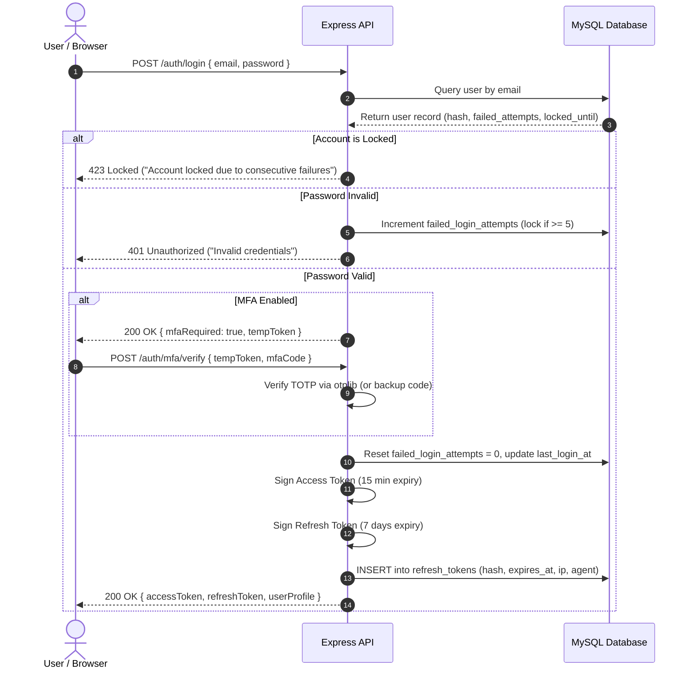

# PrimeRoute Authentication & Security Architecture

**One-line purpose:** Comprehensive specification of system authentication protocols, multi-factor authentication, cryptographic token lifecycle, attack defenses, and data protection policies.  
**Last updated:** November 16, 2026  
**Status:** Complete  

---

## 1. Authentication Protocols & Token Lifecycle

PrimeRoute implements an enterprise-grade stateless authentication mechanism utilizing short-lived JSON Web Tokens (JWT) coupled with rotatable, database-persisted refresh tokens.



### Token Characteristics:
- **Access Token:**
  - Format: Standard Signed JWT (`HS256`).
  - Lifespan: 15 minutes (`JWT_ACCESS_EXPIRES=15m`).
  - Claims: `{ userId, email, role, fullName }`.
  - Transmission: `Authorization: Bearer <token>` HTTP header.
- **Refresh Token:**
  - Lifespan: 7 days (`JWT_REFRESH_EXPIRES=7d`).
  - Storage: Persisted as a cryptographically salted hash in the `refresh_tokens` table.
  - Revocation: Instantly invalidated upon user logout (`POST /auth/logout`) or role modification.

---

## 2. Multi-Factor Authentication (MFA / TOTP)

PrimeRoute supports RFC 6238 Time-Based One-Time Password (TOTP) authentication using Google Authenticator, Authy, or standard authenticator applications.

- **Setup Flow:**
  1. Authenticated user requests MFA activation via `POST /auth/mfa/setup`.
  2. The server generates a high-entropy secret (`otplib`) and returns a standard `otpauth://` URI and QR code.
  3. The user confirms activation by supplying their first valid 6-digit TOTP code.
  4. The server encrypts and stores `mfa_secret` on `users` and sets `mfa_enabled = 1`.
- **Emergency Backup Codes:**
  - Upon MFA activation, the server generates **8 single-use emergency recovery codes**.
  - Codes are hashed using `bcrypt` and stored in `mfa_backup_codes`.
  - When an emergency backup code is used to authenticate, it is permanently marked `is_used = 1` and cannot be reused.

---

## 3. Account Lockout & Brute-Force Defenses

To defend against automated credential stuffing and dictionary attacks:
1. **Failed Attempt Tracking:**
   The `users` table tracks `failed_login_attempts`. Every incorrect password incrementation occurs synchronously in the database.
2. **Lockout Trigger:**
   If `failed_login_attempts >= 5`, the account is automatically locked for **30 minutes** (`locked_until = NOW() + INTERVAL 30 MINUTE`).
3. **Reset Condition:**
   A successful password authentication immediately resets `failed_login_attempts = 0` and clears `locked_until`.

---

## 4. User Onboarding & Password Recovery

### Administrative Invitation Flow
1. The **Owner** issues an invitation via `POST /users/invite` specifying email and system role.
2. The server generates a cryptographically random token (`crypto.randomBytes(32)`), hashes it into `invitations`, and sets `expires_at = NOW() + INTERVAL 48 HOUR`.
3. An onboarding email containing the claim URL (`https://app.primeroute.io/accept-invite?token=...`) is dispatched.
4. The recipient opens the link, defines their secure password, and activates their system account.

### Self-Service Password Reset
1. User requests recovery via `POST /auth/forgot-password`.
2. The server records a hashed reset token in `password_resets` with a strict **1-hour expiration** window.
3. The server always returns `200 OK` ("If the email exists, a reset link was sent") to prevent user enumeration.
4. Upon clicking the link and setting a new password via `POST /auth/reset-password`, the token is invalidated, all active refresh tokens for the user are revoked, and `failed_login_attempts` is reset.

### Password Strength Criteria
The backend enforces strict password validation via Zod:
- Minimum length: 8 characters (12+ recommended).
- At least 1 uppercase alphabetical character (`[A-Z]`).
- At least 1 lowercase alphabetical character (`[a-z]`).
- At least 1 numerical digit (`[0-9]`).
- At least 1 special character / symbol (`[!@#$%^&*(),.?":{}|<>]`).

---

## 5. Immutable Audit Trail (`audit_logs`)

All administrative mutations, financial transactions, permission adjustments, and critical record alterations generate a permanent entry in the `audit_logs` table:

```sql
INSERT INTO audit_logs (user_id, action, module, record_id, old_values, new_values, ip_address, user_agent)
VALUES (1, 'UPDATE_RATE', 'rentals', '42', '{"weekly_rate": 350.00}', '{"weekly_rate": 375.00}', '192.168.1.10', 'Mozilla/5.0...');
```

### Strict Immutability Rules:
- The `audit_logs` table is strictly **Insert-Only**.
- No `UPDATE` or `DELETE` SQL queries exist in the application source code for this table.
- Database triggers and application roles prevent the modification or truncation of audit logs by any user, including the Owner.

---

## 6. File Upload Policies & Validation

PrimeRoute accepts condition photos, driver licenses, inspection walk-arounds, and legal paperwork under strict file controls:

- **Storage Location:** `backend/uploads/` (stored outside public web root).
- **Multipart Handler:** `multer` with disk storage and random UUID file renaming.
- **Allowed MIME Types:**
  - Images: `image/jpeg`, `image/png`, `image/webp`
  - Documents: `application/pdf`
- **File Size Limits:**
  - Photographs: Maximum **5 MB** per image.
  - Documents & Paperwork: Maximum **10 MB** per document.
- **Path Traversal Protection:** Input filenames are completely discarded; saved filenames use UUIDv4 + verified extension (`uploads/inspections/a1b2c3d4-e5f6...jpg`).

---

## 7. HTTP Security Headers & Network Hygiene

| Security Mechanism | Implementation | Configuration & Purpose |
| :--- | :--- | :--- |
| **Helmet** | `helmet()` | Enforces `X-Content-Type-Options: nosniff`, `X-Frame-Options: DENY`, `Strict-Transport-Security`, and removes `X-Powered-By: Express`. |
| **CORS** | `cors()` | Strictly whitelist the designated frontend origin (`FRONTEND_URL`), requiring `credentials: true`. Wildcards (`*`) are prohibited. |
| **HPP** | `hpp()` | Prevents HTTP Parameter Pollution attacks by ensuring array-based parameter injections cannot bypass input filters. |
| **Global Rate Limiting**| `express-rate-limit` | Caps general API traffic to **1,000 requests per 15 minutes** per IP address. |
| **Auth Rate Limiting** | `express-rate-limit` | Caps authentication attempts to **5 attempts per 15 minutes** per IP address to eliminate automated credential guessing. |

---

## 8. Division of Security: Backend vs Frontend

| Security Concern | Frontend Responsibility | Backend Responsibility (Source of Truth) |
| :--- | :--- | :--- |
| **Route Access** | Hides navigation links and renders `<NoAccessPage />` for unauthorized views. | **Enforces 401/403 HTTP status** on every API endpoint regardless of caller origin. |
| **Driver PII Masking** | Masking utility renders dots (`••••`) on driver screens. | Sanitizes and strips sensitive PII fields in database queries before JSON serialization. |
| **Input Validation** | Client-side form feedback for user guidance. | **Strict Zod schema parsing**; rejects malformed or unwhitelisted parameters with 400 Bad Request. |
| **Session State** | Stores JWT access token in memory or secure storage; triggers auto-refresh. | Verifies cryptographic signature, expiration timestamp, and database token status on every request. |
| **Audit Logging** | Passes client context (IP / User-Agent headers). | Records immutable audit records inside database transactions. |
