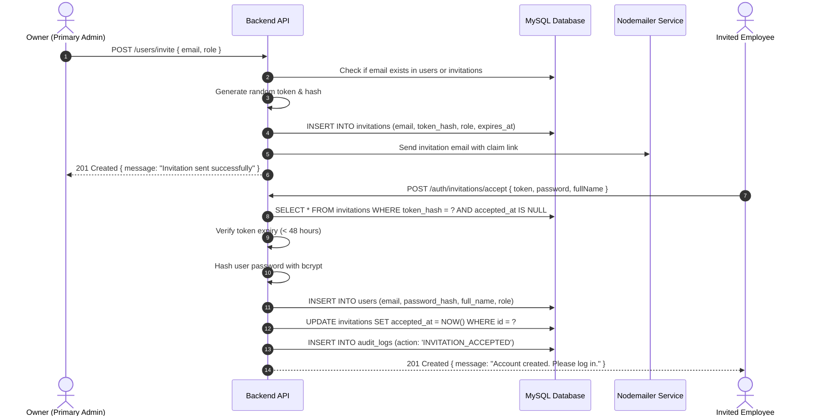
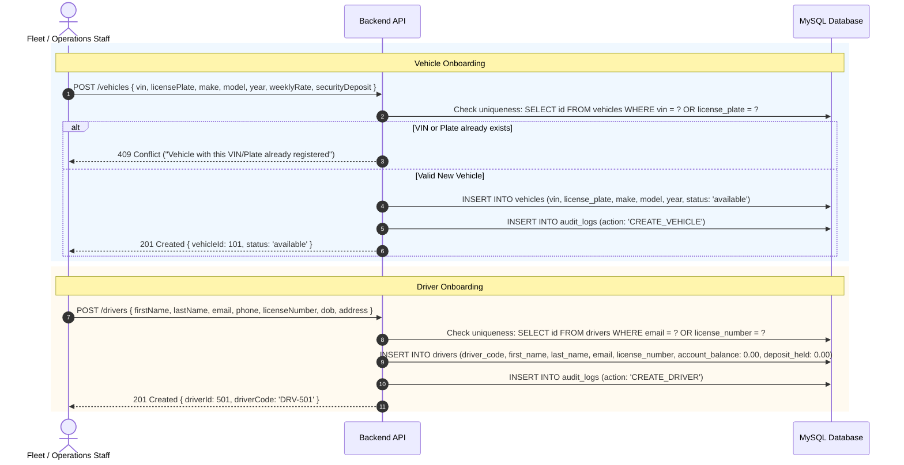
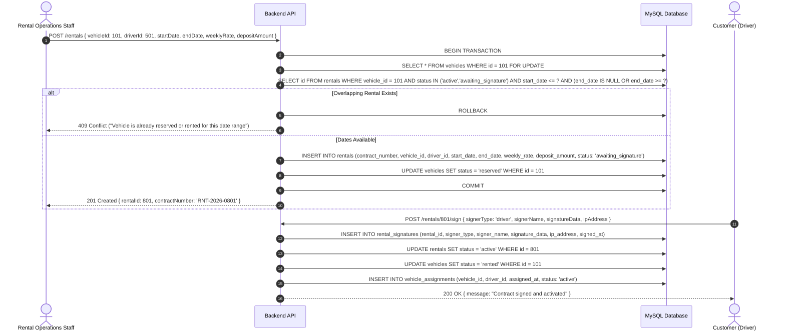
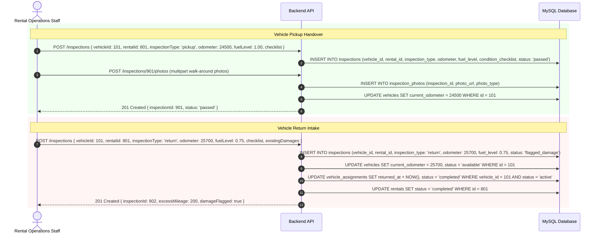
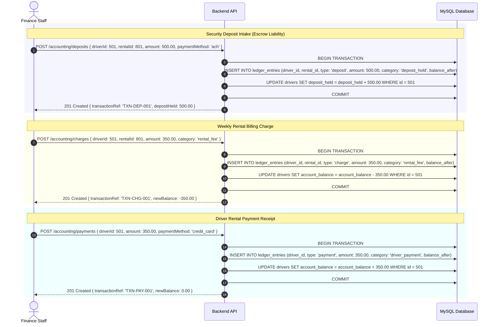
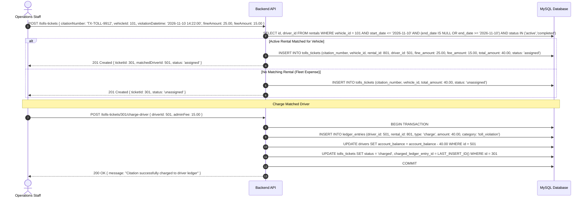
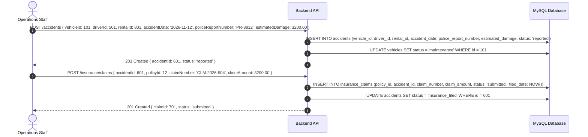
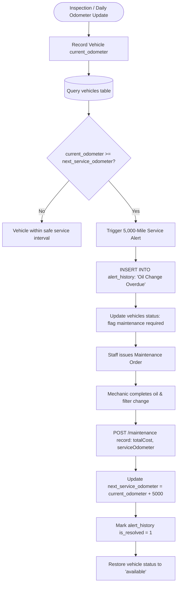

# PrimeRoute Core Data & Operational Workflows

**One-line purpose:** Step-by-step lifecycle flows with Mermaid sequence and flow diagrams detailing endpoints, database tables, and business logic execution.  
**Last updated:** November 16, 2026  
**Status:** Complete  

---

## 1. Administrative User Invitation Flow

---

## 2. Vehicle & Driver Onboarding Flow

---

## 3. Rental Creation, Overlap Protection & Digital Signature Flow

---

## 4. Vehicle Pickup & Return Inspection Flow

---

## 5. Billing, Ledger & Escrow Deposit Flow

---

## 6. Toll & Ticket Matching and Driver Charging Flow

---

## 7. Incident, Accident & Insurance Claim Flow

---

## 8. Preventative Maintenance & The 5,000-Mile Oil Change Rule

