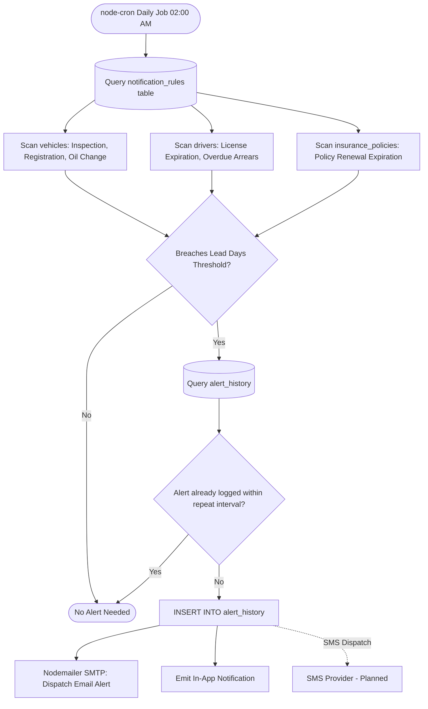

# PrimeRoute Alerts & Notification Engine Specification

**One-line purpose:** Architecture and operational rules for automated expiration warnings, maintenance thresholds, daily cron jobs, multi-channel dispatch, and resolution lifecycles.  
**Last updated:** November 16, 2026  
**Status:** Partial (Schema & Rules Seeded; Dispatch Workers Planned)  

---

## 1. Overview & Architecture

The PrimeRoute notification engine monitors fleet legal status, mechanical thresholds, driver credentials, and financial arrears. It operates via scheduled background cron jobs executing against configurable database rules:



---

## 2. Notification Rules Catalog

The system includes pre-configured event rules seeded in the `notification_rules` table:

| Event Type Constant | Description | Default Lead Days | Repeat Interval | Target Role | Channels Active |
| :--- | :--- | :---: | :---: | :--- | :--- |
| `OIL_CHANGE_DUE` | Vehicle is within 500 miles of or has passed `next_service_odometer`. | 0 (Odometer delta) | 3 Days | `fleet_maintenance` | Email, In-App (SMS Planned) |
| `INSPECTION_EXPIRING` | Vehicle state inspection sticker expires within lead days. | 30 Days | 7 Days | `fleet_maintenance` | Email, In-App (SMS Planned) |
| `REGISTRATION_EXPIRING`| Vehicle license plate registration renewal due. | 30 Days | 7 Days | `fleet_maintenance` | Email, In-App (SMS Planned) |
| `DRIVER_LICENSE_EXPIRING`| Driver license expiration date approaching. | 30 Days | 7 Days | `rental_operations` | Email, In-App (SMS Planned) |
| `INSURANCE_EXPIRING` | Commercial insurance policy expiration date approaching. | 45 Days | 7 Days | `secondary_admin` | Email, In-App (SMS Planned) |
| `OVERDUE_PAYMENT` | Driver rental account balance is delinquent past grace period. | 3 Days | 3 Days | `finance` | Email, In-App (SMS Planned) |
| `UNASSIGNED_TOLL` | Citation received from toll agency has no driver matched. | 0 Days (Immediate) | 5 Days | `rental_operations` | Email, In-App (SMS Planned) |
| `DEPOSIT_DEFICIT` | Security deposit held is below required minimum threshold. | 0 Days (Immediate) | 7 Days | `finance` | Email, In-App (SMS Planned) |

---

## 3. Scheduled Worker Implementation (`src/jobs/alertCron.js`)

Background verification is orchestrated by `node-cron` running daily during low-traffic hours (e.g., `0 2 * * *` at 2:00 AM):

```javascript
/**
 * Daily Fleet & Expiration Monitor Job (src/jobs/alertCron.js)
 * Planned implementation scheduled to run daily at 02:00 UTC.
 */

const cron = require('node-cron');
const db = require('../config/db');
const logger = require('../utils/logger');

function initAlertScheduler() {
  // Run once daily at 2:00 AM
  cron.schedule('0 2 * * *', async () => {
    logger.info('[ALERT JOB] Running daily fleet and credential expiration scan...');
    try {
      await checkExpiringInspections();
      await checkOilChangeThresholds();
      await checkExpiringLicenses();
      logger.info('[ALERT JOB] Scan completed successfully.');
    } catch (err) {
      logger.error({ err }, '[ALERT JOB] Error during alert scanning execution');
    }
  });
}

module.exports = { initAlertScheduler };
```

---

## 4. Multi-Channel Dispatch Capabilities

- **In-App Alerts (`channel_in_app`):**  
  Active alerts are surfaced in the top navigation notification bell and on the dashboard alert banner.
- **Email Notifications (`channel_email`):**  
  Dispatched using `nodemailer` via the SMTP credentials configured in `.env` (`SMTP_HOST`, `SMTP_PORT`, `SMTP_USER`, `SMTP_PASS`, `MAIL_FROM`).
- **SMS Notifications (`channel_sms`):**  
  **Status: Planned (Not implemented yet).**  
  Architecture is designed to interface with Twilio or AWS SNS for critical driver expiration alerts. The column `channel_sms` is present in `notification_rules` but defaults to `0` (disabled).

---

## 5. Alert Resolution Lifecycle

An alert in `alert_history` transitions through a deterministic lifecycle:

1. **Active State:**
   Recorded with `is_resolved = 0`, `resolved_at = NULL`, `resolved_by_user_id = NULL`.
2. **Automated Auto-Clearing:**
   When the underlying triggering condition is remedied (e.g., maintenance record entered updating `next_service_odometer`, or new vehicle registration expiration saved), the nightly scan automatically updates:
   ```sql
   UPDATE alert_history 
   SET is_resolved = 1, resolved_at = NOW() 
   WHERE entity_type = 'vehicle' AND entity_id = 101 AND is_resolved = 0;
   ```
3. **Manual Operator Resolution:**
   An authorized staff member (`owner`, `secondary_admin`, or `fleet_maintenance`) can acknowledge and dismiss an alert via the UI:
   ```http
   PATCH /api/v1/alerts/42/resolve
   ```
   The backend records the resolving user's ID (`resolved_by_user_id`) and timestamp (`resolved_at`) for audit compliance.
